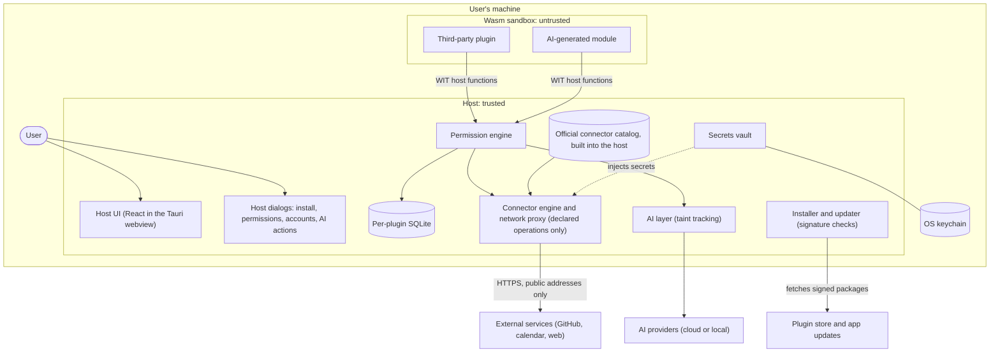

# Threat model v0

Status: draft, 2026-10-21, revised 2026-10-23 for connectors (feature 003) and 2026-10-25 for
credentials (feature 005). It describes the
planned architecture; many components do not exist yet. Revisit it at every phase gate and whenever a new component crosses a trust boundary.

The rules referenced as I–IX are the principles of the
[project constitution](../.specify/memory/constitution.md).

## System overview

Plugins never talk to the network, the keychain or the user directly: every effect goes
through a host function that the permission engine has granted. A plugin reaches an external
service only by calling an operation of a connector its manifest declares: a declaration, never
code, which the host runs, with a fixed destination and typed parameters the host checks.

## Assets

| ID | Asset | Examples | Where it lives |
| --- | --- | --- | --- |
| A1 | User data | Tasks, notes, e-mails, calendar events, repository data | Per-plugin SQLite; external services |
| A2 | Credentials | OAuth tokens, AI provider keys, passwords | OS keychain, through the host vault |
| A3 | The machine | Files, CPU, memory, network identity | Operating system |
| A4 | The user's trust decisions | Permission grants, installs, connected accounts, confirmed AI actions | Host dialogs |
| A5 | Code integrity | App updates, plugin packages | Plugin store, updater |

## Attackers

| ID | Attacker | What they control | What they want |
| --- | --- | --- | --- |
| T1 | Malicious plugin author | Code that runs in the sandbox, and its updates | Steal data or credentials, exfiltrate, phish the user, abuse the machine |
| T2 | Hostile external content | Text in e-mails, web pages, files and API responses that plugins or AI read | Inject instructions; exfiltrate through what gets rendered |
| T3 | Manipulated AI | Model output steered by T2; code of AI-generated modules | Trigger actions, request more permissions than needed, produce a malicious module |
| T4 | Supply chain | A compromised store package, app update or dependency | Run code with more trust than it earned |

## Trust boundaries

| ID | Boundary | What crosses it | Controls |
| --- | --- | --- | --- |
| B1 | Plugin ↔ host (Wasm sandbox, WIT interface) | Host function calls, widget render data, named values the plugin stores | WebAssembly only (I); no capabilities until granted, only granted imports linked (II); CPU, memory and time limits; storage bound at link time to the plugin's id and origin, run by the host's own statements on a hardened SQLite connection, within a quota the user approved, read-only in render and all or nothing in update |
| B2 | Host ↔ network | Connector calls a plugin makes | No generic network: only declared operations of connectors, run by the host (III); destinations from the catalog, whose domains are reserved, or local in development; HTTPS with Mozilla's roots, public addresses only at every connection, redirects only to the connector's origins, no system proxy, no cookies; size, time, call and rate limits; a request log no plugin can read or flood; calls only in `update`, never in render |
| B3 | Host ↔ secrets | Tokens and keys, the sign-in | Kept only in the OS keychain, through the host's vault; never handed to plugins: the host adds them to each hop of a request to the credential's own HTTPS origins, in its one header, and withholds any response that carries them back (IV); accounts connected only from the host's controls, with the authorization code and PKCE on a loopback redirect (VII) |
| B4 | Plugin UI ↔ user | Widget content | Declarative UI inside the host frame, no password fields, no windows or dialogs (V); personal visual secret on every host dialog |
| B5 | AI ↔ host | Prompts out, model output in | Output treated as untrusted: safe rendering, taint tracking, human confirmation of actions (VI); trust decisions only in host dialogs (VII) |
| B6 | Distribution ↔ host | Plugin packages, app updates | ed25519 signatures, hash check on install, revocation list, signed updater |

## Threats and planned tests

Each row is a hostile plugin or hostile content that must fail in CI (principle VIII). The
suite grows with every phase and never shrinks.

| Threat | Attacker | Asset | Boundary | Mitigation | Test from |
| --- | --- | --- | --- | --- | --- |
| Infinite loop freezes the machine | T1 | A3 | B1 | Fuel or epoch interruption, call timeout | Phase 1 |
| Huge memory allocation freezes the machine | T1 | A3 | B1 | Memory limiter | Phase 1 |
| Opens a file or socket without permission | T1 | A1, A3 | B1 | I, II | Phase 1 |
| Reads memory outside its own sandbox | T1 | A1, A2 | B1 | WebAssembly memory bounds (I) | Phase 1 |
| Keeps state between calls or reaches another plugin's state | T1 | A1 | B1 | Fresh instance per call | Phase 1 |
| Recurses until the stack runs out | T1 | A3 | B1 | WebAssembly stack limit; the call fails, the host keeps running | Phase 1 |
| Returns malformed or oversized widget content | T1 | A3 | B1 | JSON check and output size cap | Phase 1 |
| Floods the host with log messages | T1 | A3 | B1 | Per-call log caps | Phase 1 |
| Log or error text imitates the host's own output | T1 | A4 | B1 | Plugin text escaped before display | Phase 1 |
| Sends data to a destination of its choosing (generic network, `wasi:http`, sockets) | T1, T3 | A1 | B1, B2 | No such capability: only declared connector operations (III) | Phase 2 |
| Calls an operation its manifest does not declare, or with a value outside its type to reach another path or host | T1 | A1 | B2 | The host checks every call against the declaration, and encodes each value in its own place (III) | Phase 2 |
| Connector hides a change as a read (a `POST` read, or `X-HTTP-Method-Override` on a `GET`) | T1 | A1 | B2 | Outside the catalog a read is a body-less `GET` or `HEAD`, and no `X-` header is fixed; the catalog's kinds are reviewed by hand (III, IX) | Phase 2 |
| Impostor connector claims a catalog service (`api.github.com`, `catalog/github`, a case or trailing-dot variant) | T1, T4 | A1, A4 | B2 | The catalog is built into the host and its domains, with every host under them, are reserved; hosts compared in one normal form (III) | Phase 2 |
| Connector from a repository reaches a domain its owner never authorized | T1 | A1 | B2 | Refused until installation verifies the owner's authorization (Phase 3) | Phase 2 |
| Destination or redirect leads to the user's machine, local network or a cloud metadata address (also through DNS rebinding) | T1, T2 | A1, A3 | B2 | Only public addresses, checked at every connection; IP destinations refused; redirects only to the connector's own origins, exact port included (III) | Phase 2 |
| Certificate makes the operating system fetch revocation or root data outside the host proxy | T1, T2 | A1 | B2 | rustls' own verifier over Mozilla's roots, the same on every system; the system verifiers are banned from the build (III) | Phase 2 |
| System network proxy hides which address a request reaches | T2 | A1 | B2 | System proxies are never used; requests go straight to their checked destination (III) | Phase 2 |
| Floods the request log to push earlier entries out, or forges entries | T1 | A4 | B2 | Past a run's call limit, one summary entry; names and values cut before writing and escaped when shown (III) | Phase 2 |
| Approval covers something else than what was shown (the connector changed in between) | T1 | A4 | B2 | `approve` grants only the digest `permissions` printed; a connector change that widens what the widget reaches needs a new approval (II, VII) | Phase 2 |
| Waits on the network in render to stall the dashboard | T1 | A3 | B1, B2 | Connectors are called only in `update`, with its own time limit; render shows the data the host kept (III) | Phase 2 |
| Connector hides a credential in a fixed value | T1 | A2 | B3 | Fixed values are public, shown before approval; a credential is declared only in `credential` and kept by the host, and a connector that fixes its header is refused (IV) | Phase 2 (`fixed-auth-header`) |
| Reads or changes another plugin's storage, by using its names or by claiming its id from another file | T1 | A1 | B1 | One database per plugin, chosen by the host at link time from the plugin's id and origin; no call names a store, file or place (II) | Phase 2 (`other-plugin`, `same-id-other-origin`, `store-binding`) |
| Stored names that look like paths, SQL or `ATTACH` reach outside the plugin's store | T1 | A1, A3 | B1 | Names are opaque bytes bound as parameters to the host's own statements; no attached databases, no extensions, defensive mode, triggers and views off, and an authorizer that allows only the host's statements | Phase 2 (`name-injection`, `store-hardened`) |
| Opens the store file directly through the file system | T1 | A1 | B1 | No file system capability (I, II) | Phase 2 (`storage-file`) |
| A store file changed outside the host (an extra table, a trigger, a view, another plugin's file) runs code or passes for another store | T1, T4 | A1 | B1 | The schema and identity checked at every open; a file that differs is damaged, and nothing in it runs or changes | Phase 2 (`foreign-store`) |
| Fills the user's disk, or slows the host with endless tiny writes | T1 | A3 | B1 | A quota the user approves, counted the same on every system; limits on names, values, calls and bytes per update; a file cap SQLite enforces | Phase 2 (`quota-fill`, `many-entries`, `churn`, `file-cap-hit`, `over-limits`) |
| A new version raises its quota without the user | T1, T4 | A3, A4 | B1 | The approval digest covers the quota; a larger quota needs a new approval (II) | Phase 2 (`quota-raised`, `approval-digest`) |
| An update killed or failing halfway leaves half-written data | T1 | A1 | B1 | Each update is one transaction, committed only when it returned `ok`; any failed write, a full file or a killed process ends it with nothing kept | Phase 2 (`crash-after-writes`, `killed-mid-update`, `unwritable-store`) |
| Writes from render, which the host may run at any time | T1 | A1 | B1 | Render's connection is read-only and its writes refused | Phase 2 (`write-in-render`) |
| Keeps writing after the user turned storage off or removed the approval | T1 | A1, A4 | B1 | The grant record read again on every call and at the commit, under its lock (II) | Phase 2 (`optional-off`, `taken-away-mid-update`) |
| Stored names and values imitate the CLI's output when shown | T1 | A4 | B1 | Every text quoted and escaped, `"` and `\` included, one entry per line | Phase 2 (`show-spoof`) |
| Reads a credential from the plugin's side: its environment, arguments, configuration, the keychain's files, the host records, any import | T1 | A2 | B1, B3 | No import, file, variable or argument carries one; WASI imports are refused; the host adds the credential to the request itself (I, II, IV) | Phase 2 (`token-hunt`) |
| A destination sends the credential back, raw or escaped, in its body, a header or a redirect | T1, T2 | A2 | B2, B3 | Every response checked for the credential in each form an encoder or a URL could write it; one that holds it is `failed(invalid-response)`, and the widget gets nothing of it (IV) | Phase 2 (`echo-body`, `echo-header`, `echo-location`, `echo-json-escaped`, `credential_rules`) |
| The credential sent to another host: another destination, a redirect, token, revoke or identity addresses elsewhere, plain HTTP, an invalid certificate, a parameter that builds a header | T1 | A2 | B2, B3 | Added per hop only for the credential's own origins, over HTTPS with a valid certificate; every destination of a connector with a credential is HTTPS; token, revoke and identity on the credential's destinations; the header is the host's, never fixed and never built from a parameter (III, IV) | Phase 2 (`other-destination`, `redirect-other-host`, `token-host-elsewhere`, `identity-elsewhere`, `plain-http-credential`, `plain-http-beside`, `bad-certificate`, `header-smuggling`, `credential_combinations`) |
| A widget acts as an account it was not approved to use: no account use declared, the connector optional and off, the other interface, a copied widget id or connector file | T1 | A1, A2, A4 | B1 | Account use declared, approved and linked at load in a table of its own; a call through the other interface is `not-granted`; approvals and accounts belong to their origins (II) | Phase 2 (`no-account-use`, `optional-off`, `wrong-interface`, `copied-widget-id`, `copied-connector-id`) |
| A widget starts a sign-in or opens the browser | T1 | A2, A4 | B4 | No import can; only the host's controls connect, reconnect or disconnect an account (VII) | Phase 2 (`widget-connect`) |
| Forged or replayed sign-in: a callback with a wrong or missing state, a code already used, a callback after the time limit | T1, T2 | A2, A4 | B3 | PKCE (S256) and a fresh state per sign-in; a loopback listener on a port the system chooses, closed after the first callback or the time limit; nothing kept before the exchange and the identity call succeed (IV, VII) | Phase 2 (`forged-callback`, `replayed-code`, `late-callback`) |
| A sign-in phished with a device code the attacker started | T1, T2 | A2, A4 | B3 | No device flow: the person approving a device code cannot tell whose flow it is, so the host signs in only with the authorization code and PKCE on a loopback redirect it started itself; GitHub, whose web flow needs a client secret, waits for Phase 6 (IV, VII) | Phase 2 (`connector_schema`: no other flow is accepted) |
| Another account slipped in when an account connects again | T2 | A1, A4 | B3 | The new identity's stable id compared with the connected account's; another one is `another-account-connected`, its token revoked and dropped, the earlier account kept (VII) | Phase 2 (`another-account`) |
| One widget locks an account out for every widget, through a `401` on one operation | T1, T2 | A4 | B2 | A `401` gets one refresh and one resend, then the identity call: the account is marked only when the service refuses that too; no retry loop (VII) | Phase 2 (`foreign-401`, `revoked-token`, `expired-refresh`) |
| An account appears or disappears while a widget runs | T1 | A1, A2 | B1, B3 | The account is fixed at load; a call checks again and only takes away: a disconnect drops the response in flight, later calls go without; a new account applies from the next load (II) | Phase 2 (`disconnect-mid-run`, `connect-mid-run`) |
| An update widens what an account lets a widget do, silently | T1, T4 | A2, A4 | B1 | The approval covers the credential, the account use and the access; a credential added or changed, account use started or access widened needs a new approval, and the account connects again (II, VII) | Phase 2 (`credential-added-update`, `access-widened-update`) |
| A secret in an error, a log, kept data, a record or the tool's output | T1, T2 | A2 | B3 | Keychain errors mapped to text without their payload; the credential prints as `[credential]`; after every case, a scan for every secret the test service issued in every file and output (IV) | Phase 2 (`secret_free_errors`, the scan of every credential case) |
| An account name imitates the tool's output | T2 | A4 | B3 | Kept escaped, printed escaped by every command (VII) | Phase 2 (`account-spoof`) |
| Another process of the user reads the keychain | — | A2 | B3 | Outside the model: the OS keychain's own access control decides; the development vault is a keychain service of its own, which installed plugins never use | — |
| Obtains an AI provider key | T1, T3 | A2 | B3 | The same vault and rules (IV) | Phase 4 |
| Update adds a permission without approval | T1, T4 | A4 | B1 | Re-approval on new permissions (II) | Phase 2 |
| Uses an optional capability the user left off | T1 | A1, A2 | B1 | A stand-in that gives nothing and answers "not granted" (II) | Phase 2 |
| Package carries two manifests, or one in a nested part, so a tool and the host read different ones | T1 | A4 | B1 | Exactly one top-level manifest section; any other package is refused (`manifest-mismatch`) | Phase 2 |
| Plugin reads or changes its own grants | T1 | A4 | B1 | Plugins have no file access; grants change only through the host's controls (VII); running a plugin never writes the record | Phase 2 |
| Development package claims an installed plugin's id to inherit its grants | T1 | A4 | B1 | The development record is separate from the installed one, and a load consults only one | Phase 2 |
| Local file copies an approved plugin's id to inherit its grants | T1 | A4 | B1 | A development approval belongs to the file it was approved from; another file gets none of its grants | Phase 2 |
| Package crafted to be slow or memory-hungry to compile, which no per-call limit covers; compiling uses every core | T1, T4 | A3 | B1, B6 | Today only the 10 MiB package cap: a package near it took up to 0.8 s and about 590 MB to load on CI ([performance.md](../specs/001-plugin-runtime/performance.md)); planned: compile at install, in a separate process with OS limits | Phase 3 |
| Package reuses a renamed or deleted repository's name (repo-jacking) to inherit an installed plugin's grants | T4 | A1, A4 | B6 | Install only from repositories; keep the repository's permanent identifier at install, and accept updates only from it; signatures (Phase 6) | Phase 3 |
| Password field or drawing over the frame (fake login) | T1 | A2 | B4 | V | Phase 3 |
| Widget opens a window or dialog (phishing) | T1 | A2, A4 | B4 | V, VII | Phase 3 |
| Asks for little at install, then presses the user to turn on optional permissions one at a time | T1 | A1, A4 | B4 | Only host controls turn a permission on (VII); the dangerous-combination warning runs on every grant change, judged on the permissions the plugin will hold afterwards | Phase 3 |
| Hidden instruction in content read by AI (prompt injection) | T2, T3 | A1, A4 | B5 | VI, taint tracking | Phase 4 |
| Remote image with data in its URL in AI output | T2, T3 | A1 | B5 | Safe rendering without remote resources | Phase 4 |
| Generated module calls a connector the user did not mention | T3 | A1 | B1, B2 | Permissions derived from the user's request | Phase 5 |
| Data read from one connected account or from the local network reaches another destination | T1 | A1 | B2 | `permissions` already says when data read from this machine can reach another destination; the cross-account warning arrives in the host dialogs (III) | Phase 3 |
| Package with an invalid or revoked signature | T4 | A5 | B6 | Signature, hash and revocation checks | Phase 6 |

## Assumptions and out of scope

- Trusted: the operating system, the OS keychain and its access control between the user's
  processes, and the sandboxing of Wasmtime and the webview. Their vulnerabilities are handled by pinned versions, `cargo audit` and fast
  updates, not by this design.
- Out of scope: malware already running on the machine, an attacker with administrator or
  physical access, and the AI provider reading the prompts the user chose to send it.

## Open questions

- Does the plugin runtime run in a separate OS process? Not during Phase 1:
  [decision 0001](decisions/0001-plugin-process-isolation.md) explains why and when to revisit
  it, in Phase 3's plan at the latest.
- How is widget render data turned into UI in the webview, and which Content Security Policy
  does the app ship? The template default (`"csp": null` in `app/src-tauri/tauri.conf.json`)
  must become restrictive by Phase 3.
- How does taint propagate across plugin calls, storage and later executions? Phase 4.
- Where are third-party plugins installed from, and how is the installed version pinned?
  Decided on 2026-10-22 (feature 002): only from their authors' repositories, never from a
  file and never from this repository. One plugin per repository, whose id is the repository
  (`github.com/<owner>/<repository>`). Installing points to an exact release (tag plus file
  hash), downloads the published component, keeps the repository's permanent identifier and,
  from Phase 6, verifies the signature; it never follows a branch or builds from source on the
  user's machine. Plugins that come from no repository (development builds, examples, test
  fixtures and, in Phase 5, modules generated on the user's machine) use local ids
  (`local/<name>`). Installation arrives in Phase 3; the store in Phase 6.
