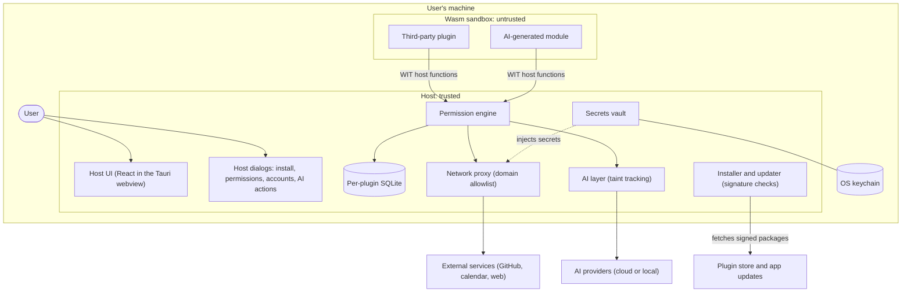

# Threat model v0

Status: draft, 2026-10-21. It describes the planned architecture; most components do not exist
yet. Revisit it at every phase gate and whenever a new component crosses a trust boundary.

The rules referenced as I–IX are the principles of the
[project constitution](../.specify/memory/constitution.md).

## System overview

Plugins never talk to the network, the keychain or the user directly: every effect goes
through a host function that the permission engine has granted.

## Assets

| ID | Asset | Examples | Where it lives |
| --- | --- | --- | --- |
| A1 | User data | Tasks, notes, e-mails, calendar events, repository data | Per-plugin SQLite; external services |
| A2 | Credentials | OAuth tokens, AI provider keys, passwords | OS keychain, through the host vault |
| A3 | The machine | Files, CPU, memory, network identity | Operating system |
| A4 | The user's trust decisions | Permission grants, installs, connected accounts, confirmed AI actions | Host dialogs |
| A5 | Code integrity | App updates, plugin packages | Plugin store, updater |

## Attackers

| ID | Attacker | What they control | What they want |
| --- | --- | --- | --- |
| T1 | Malicious plugin author | Code that runs in the sandbox, and its updates | Steal data or credentials, exfiltrate, phish the user, abuse the machine |
| T2 | Hostile external content | Text in e-mails, web pages, files and API responses that plugins or AI read | Inject instructions; exfiltrate through what gets rendered |
| T3 | Manipulated AI | Model output steered by T2; code of AI-generated modules | Trigger actions, request more permissions than needed, produce a malicious module |
| T4 | Supply chain | A compromised store package, app update or dependency | Run code with more trust than it earned |

## Trust boundaries

| ID | Boundary | What crosses it | Controls |
| --- | --- | --- | --- |
| B1 | Plugin ↔ host (Wasm sandbox, WIT interface) | Host function calls, widget render data | WebAssembly only (I); no capabilities until granted, only granted imports linked (II); CPU, memory and time limits |
| B2 | Host ↔ network | Plugin HTTP requests | Host proxy with per-domain allowlist (III); HTTPS only; size and rate limits; request log |
| B3 | Host ↔ secrets | Tokens and keys | Never handed to plugins; the host injects them into requests (IV) |
| B4 | Plugin UI ↔ user | Widget content | Declarative UI inside the host frame, no password fields, no windows or dialogs (V); personal visual secret on every host dialog |
| B5 | AI ↔ host | Prompts out, model output in | Output treated as untrusted: safe rendering, taint tracking, human confirmation of actions (VI); trust decisions only in host dialogs (VII) |
| B6 | Distribution ↔ host | Plugin packages, app updates | ed25519 signatures, hash check on install, revocation list, signed updater |

## Threats and planned tests

Each row is a hostile plugin or hostile content that must fail in CI (principle VIII). The
suite grows with every phase and never shrinks.

| Threat | Attacker | Asset | Boundary | Mitigation | Test from |
| --- | --- | --- | --- | --- | --- |
| Infinite loop freezes the machine | T1 | A3 | B1 | Fuel or epoch interruption, call timeout | Phase 1 |
| Huge memory allocation freezes the machine | T1 | A3 | B1 | Memory limiter | Phase 1 |
| Opens a file or socket without permission | T1 | A1, A3 | B1 | I, II | Phase 1 |
| Reads memory outside its own sandbox | T1 | A1, A2 | B1 | WebAssembly memory bounds (I) | Phase 1 |
| Keeps state between calls or reaches another plugin's state | T1 | A1 | B1 | Fresh instance per call | Phase 1 |
| Recurses until the stack runs out | T1 | A3 | B1 | WebAssembly stack limit; the call fails, the host keeps running | Phase 1 |
| Returns malformed or oversized widget content | T1 | A3 | B1 | JSON check and output size cap | Phase 1 |
| Floods the host with log messages | T1 | A3 | B1 | Per-call log caps | Phase 1 |
| Log or error text imitates the host's own output | T1 | A4 | B1 | Plugin text escaped before display | Phase 1 |
| Requests a domain outside the allowlist | T1, T3 | A1 | B2 | III | Phase 2 |
| Reads another plugin's storage | T1 | A1 | B1 | One database per plugin, II | Phase 2 |
| Obtains an OAuth token or AI key | T1 | A2 | B3 | IV | Phase 2 |
| Update adds a permission without approval | T1, T4 | A4 | B1 | Re-approval on new permissions (II) | Phase 2 |
| Uses an optional capability the user left off | T1 | A1, A2 | B1 | A stand-in that gives nothing and answers "not granted" (II) | Phase 2 |
| Package carries two manifests, or one in a nested part, so a tool and the host read different ones | T1 | A4 | B1 | Exactly one top-level manifest section; any other package is refused (`manifest-mismatch`) | Phase 2 |
| Plugin reads or changes its own grants | T1 | A4 | B1 | Plugins have no file access; grants change only through the host's controls (VII); running a plugin never writes the record | Phase 2 |
| Development package claims an installed plugin's id to inherit its grants | T1 | A4 | B1 | The development record is separate from the installed one, and a load consults only one | Phase 2 |
| Local file copies an approved plugin's id to inherit its grants | T1 | A4 | B1 | A development approval belongs to the file it was approved from; another file gets none of its grants | Phase 2 |
| Package crafted to be slow or memory-hungry to compile, which no per-call limit covers; compiling uses every core | T1, T4 | A3 | B1, B6 | Today only the 10 MiB package cap: a package near it took up to 0.8 s and about 590 MB to load on CI ([performance.md](../specs/001-plugin-runtime/performance.md)); planned: compile at install, in a separate process with OS limits | Phase 3 |
| Package reuses a renamed or deleted repository's name (repo-jacking) to inherit an installed plugin's grants | T4 | A1, A4 | B6 | Install only from repositories; keep the repository's permanent identifier at install, and accept updates only from it; signatures (Phase 6) | Phase 3 |
| Password field or drawing over the frame (fake login) | T1 | A2 | B4 | V | Phase 3 |
| Widget opens a window or dialog (phishing) | T1 | A2, A4 | B4 | V, VII | Phase 3 |
| Asks for little at install, then presses the user to turn on optional permissions one at a time | T1 | A1, A4 | B4 | Only host controls turn a permission on (VII); the dangerous-combination warning runs on every grant change, judged on the permissions the plugin will hold afterwards | Phase 3 |
| Hidden instruction in content read by AI (prompt injection) | T2, T3 | A1, A4 | B5 | VI, taint tracking | Phase 4 |
| Remote image with data in its URL in AI output | T2, T3 | A1 | B5 | Safe rendering without remote resources | Phase 4 |
| Generated module requests a domain the user did not mention | T3 | A1 | B1, B2 | Permissions derived from the user's request | Phase 5 |
| Package with an invalid or revoked signature | T4 | A5 | B6 | Signature, hash and revocation checks | Phase 6 |

## Assumptions and out of scope

- Trusted: the operating system, the OS keychain, and the sandboxing of Wasmtime and the
  webview. Their vulnerabilities are handled by pinned versions, `cargo audit` and fast
  updates, not by this design.
- Out of scope: malware already running on the machine, an attacker with administrator or
  physical access, and the AI provider reading the prompts the user chose to send it.

## Open questions

- Does the plugin runtime run in a separate OS process? Not during Phase 1:
  [decision 0001](decisions/0001-plugin-process-isolation.md) explains why and when to revisit
  it, in Phase 3's plan at the latest.
- How is widget render data turned into UI in the webview, and which Content Security Policy
  does the app ship? The template default (`"csp": null` in `app/src-tauri/tauri.conf.json`)
  must become restrictive by Phase 3.
- How does taint propagate across plugin calls, storage and later executions? Phase 4.
- Where are third-party plugins installed from, and how is the installed version pinned?
  Decided on 2026-10-22 (feature 002): only from their authors' repositories, never from a
  file and never from this repository. One plugin per repository, whose id is the repository
  (`github.com/<owner>/<repository>`). Installing points to an exact release (tag plus file
  hash), downloads the published component, keeps the repository's permanent identifier and,
  from Phase 6, verifies the signature; it never follows a branch or builds from source on the
  user's machine. Plugins that come from no repository (development builds, examples, test
  fixtures and, in Phase 5, modules generated on the user's machine) use local ids
  (`local/<name>`). Installation arrives in Phase 3; the store in Phase 6.
